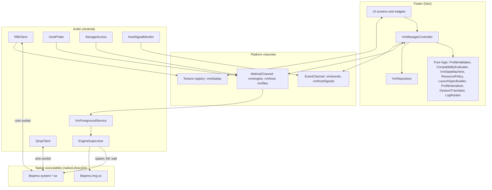
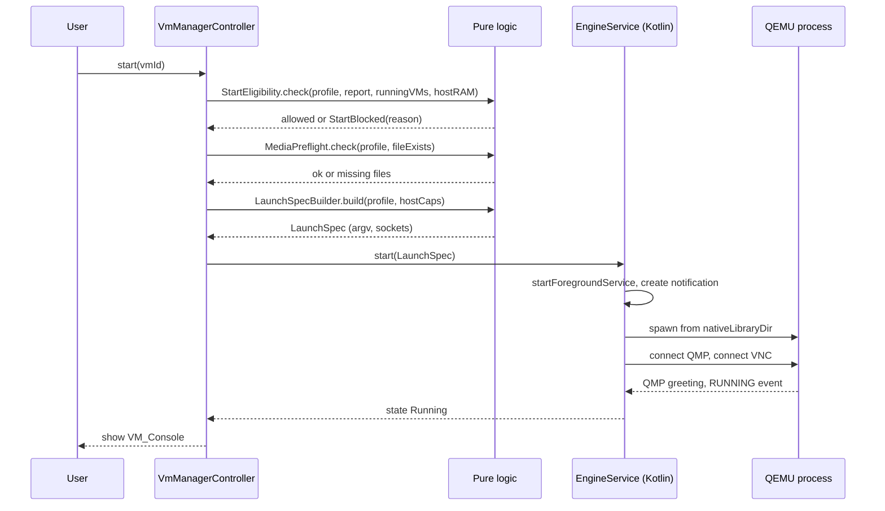
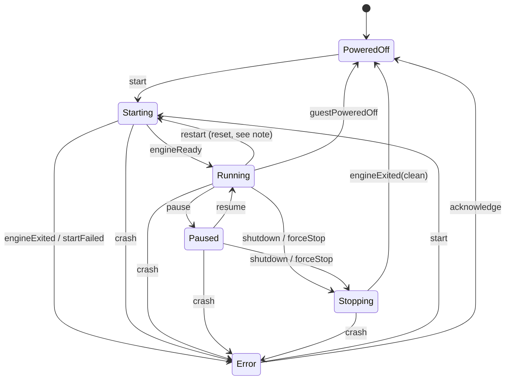

# Design Document: Android VM Manager

## Overview

The Android VM Manager is a Flutter application (project `vm_machine`) that creates and runs virtual machines on Android phones and tablets. A native emulation engine, QEMU, runs the guests. Flutter owns the UI and all decision logic. Kotlin owns Android platform integration (foreground service, process control, storage access, sensors). QEMU runs as a separate process that Kotlin supervises.

### Key design decisions

| # | Decision | Rationale |
|---|----------|-----------|
| D1 | Ship QEMU as prebuilt executables named `lib*.so` in `jniLibs/arm64-v8a`, and launch them from `ApplicationInfo.nativeLibraryDir`. | Android 10+ blocks executing files written to app-private storage (W^X policy). Files in the native library directory are still executable. This is the same approach other Android QEMU front ends use ([Shipping QEMU in an APK](https://dev.to/ai2th/linxr-part-2-shipping-qemu-in-an-apk-4kij), [Executing Binaries on Android](https://dev.to/ai2th/pockr-part-2-executing-binaries-on-android-3b4k)). |
| D2 | Run QEMU as a child process, not as an in-process library. | A QEMU crash does not take down the app. The exit code and stderr give the exit reason (Req 5.8). `SIGKILL` gives a reliable force stop (Req 5.5). |
| D3 | Control QEMU with QMP over a Unix domain socket in the app's private directory. | QMP covers pause, resume, reset, ACPI power-off, snapshots, and status. It needs no network port. |
| D4 | Expose the guest display and input through QEMU's built-in VNC server on a Unix socket (`-vnc unix:`). A Kotlin RFB client decodes frames into a Flutter `Texture`. | It is the simplest cross-platform display path and works with software emulation. Input uses the same RFB connection. A faster shared-memory path can replace it later without changing the Dart API. |
| D5 | Use software emulation (TCG) as the baseline. Use KVM or AVF only when the Capability_Detector reports it. | Regular Android apps cannot open `/dev/kvm` on most devices. A custom-kernel device exposing `/dev/kvm` is the exception ([QubeVM notes](https://github.com/psyphyaudio/QubeVM)). |
| D6 | Keep every rule that the requirements express as a threshold, filter, or mapping in pure Dart functions with no I/O. | These rules are testable with property-based tests and do not need a device. |
| D7 | Store VM profiles as JSON files, one per VM, plus an index. Use the same JSON schema for export and import. | Fulfills persistence (Req 10.1) and export (Req 10.5) with one serializer. |
| D8 | Use qcow2 for virtual disks. Create them with `qemu-img` (also shipped as `libqemu-img.so`) with `preallocation=off`. Use qcow2 internal snapshots. | Sparse allocation (Req 8.2) and snapshot support (Req 9) come from the same format. |
| D9 | Flutter state management uses Riverpod. Services are behind abstract interfaces so tests can supply fakes. | Isolates platform code from logic. |

### Scope boundary

The design covers the 12 requirements. It does not cover GPU passthrough, cloud VMs, or remote desktop. The design does not include any Windows or macOS installation media, and does not download any.

## Architecture



### Layering rules

1. UI widgets only call `VmManagerController` and watch Riverpod providers.
2. `VmManagerController` orchestrates. It calls pure logic first to decide, then platform services to act.
3. Platform services (engine, host probe, file access) are abstract Dart interfaces with a Kotlin-backed implementation and an in-memory fake.
4. Pure logic never imports Flutter, `dart:io`, or platform channels.

### VM start sequence



Each step that fails produces a `StartFailure(step, cause)` that the UI shows (Req 12.1).

### VM lifecycle state machine



Note: restart sends a QMP `system_reset`. The engine process keeps running, so the state returns to `Running` after the guest reset event. The `Starting` edge from `Running` models the interval while the guest reboots, and the transition back to `Running` is `engineReady`.

## Components and Interfaces

### Dart: domain and pure logic (`lib/domain/`)

```dart
enum GuestOs { linux, windows, macos }
enum GuestArch { arm64, x86_64 }
enum AccelerationMode { softwareEmulation, hardwareVirtualization }
enum VmState { poweredOff, starting, running, paused, stopping, error }
enum NetworkMode { nat }               // Req 11.1; extensible later
enum MediaStatus { present, missing }

/// Value that may fail detection (Req 1.7).
sealed class Detected<T> { const Detected(); }
class Known<T> extends Detected<T> { final T value; const Known(this.value); }
class Unknown<T> extends Detected<T> { const Unknown(); }
```

**HostCapabilities / CompatibilityEvaluator**

```dart
class HostCapabilities {
  final Detected<GuestArch> arch;
  final Detected<int> totalRamBytes;
  final Detected<int> freeStorageBytes;
  final Detected<int> cpuCores;
  final Detected<bool> hardwareVirtualization;
}

class CompatibilityEntry {
  final GuestOs os;
  final GuestArch arch;
  final bool runnable;
  final AccelerationMode? mode;       // null when not runnable
  final List<CompatibilityWarning> warnings;
  final String? blockedReason;
}

class CompatibilityReport {
  final HostCapabilities host;
  final List<CompatibilityEntry> entries;   // one per (GuestOs, GuestArch)
}

abstract final class CompatibilityEvaluator {
  static CompatibilityReport evaluate(HostCapabilities host);
}
```

Rules implemented by `evaluate`:
- An ARM64 guest on a host that reports ARM64 and `hardwareVirtualization == Known(true)` gets `hardwareVirtualization`. Every other runnable entry gets `softwareEmulation` (Req 1.3, 1.4).
- An x86_64 guest on a non-x86_64 host (or unknown host arch) gets `softwareEmulation` and a `reducedPerformance` warning (Req 1.3).
- If total RAM is `Known(r)` and `r < 4 GiB`, Windows and macOS entries get a `notRecommendedLowRam` warning (Req 1.5).
- Unknown fields stay `Unknown` in `report.host`, and no entry is marked non-runnable only because a value is `Unknown` (Req 1.7).
- An entry is non-runnable only when a known fact makes it impossible. The first release marks nothing non-runnable except where the engine lacks a build for that pair (carried as `EngineCatalog.supports(os, arch)`), and the reason is recorded in `blockedReason` (Req 2.7).

**StartEligibility**

```dart
sealed class StartDecision {}
class StartAllowed extends StartDecision {}
class StartBlocked extends StartDecision { final String reason; }

abstract final class StartEligibility {
  static StartDecision check({
    required VmProfile profile,
    required CompatibilityReport report,
    required List<VmProfile> runningVms,
    required Detected<int> hostRamBytes,
  });
}
```
Blocks when the profile's (os, arch) entry is non-runnable (Req 2.7), or when `sum(memory of runningVms) + profile.memoryMiB` exceeds 75 percent of known host RAM (Req 5.9). With unknown host RAM the memory rule is skipped.

**ProfileValidator**

```dart
class ProfileDraft { /* same fields as VmProfile minus id; licenseAcknowledged */ }

class ValidationIssue {
  final ValidationField field;       // name, memory, cpu, disk, media, license, port, ...
  final String message;
  final num? limit;                  // the maximum or available amount shown to the user
}

abstract final class ProfileValidator {
  static List<ValidationIssue> validate({
    required ProfileDraft draft,
    required Iterable<String> existingNames,   // excludes the profile being edited
    required HostCapabilities host,
  });
}
```
Rules: non-empty trimmed name that is unique (case-insensitive) (Req 3.4); `memoryMiB <= 0.75 * totalRam` with the limit reported (Req 3.5); `cpuCount <= cpuCores` (Req 3.6); `diskBytes <= freeStorage` with free storage reported (Req 3.7); at least one Installation_Media entry (Req 2.2); macOS requires `licenseAcknowledged` (Req 2.5); each port forward uses a host port in 1024..65535 (Req 11.3). Rules whose host value is `Unknown` are skipped. The same function validates create and edit (Req 3.8).

**Defaults**

`RecommendedDefaults.forOs(GuestOs)` returns `(cpuCount, memoryMiB, diskBytes)`. Linux: 2 vCPU, 2048 MiB, 16 GiB. Windows: 4 vCPU, 4096 MiB, 64 GiB. macOS: 4 vCPU, 4096 MiB, 64 GiB. Values are clamped to host limits by the UI before display.

**VmStateMachine**

```dart
sealed class VmEvent {}  // Start, EngineReady, Pause, Resume, Shutdown, ForceStop,
                         // Restart, GuestPoweredOff, EngineExited(code, reason),
                         // EngineCrashed(reason), Acknowledge, NetworkChanged(bool)

abstract final class VmStateMachine {
  static VmTransition apply(VmState state, VmEvent event);
}
class VmTransition { final VmState next; final String? errorReason; final bool accepted; }
```
Illegal events return `accepted: false` and `next == state`. `NetworkChanged` never changes state (Req 11.4). Any crash event from `starting`, `running`, `paused`, or `stopping` yields `error` with the reason (Req 5.8).

**LaunchSpecBuilder**

```dart
class LaunchSpec {
  final String executable;           // e.g. libqemu-system-x86_64.so
  final List<String> args;
  final String qmpSocketPath;
  final String vncSocketPath;
  final String logPath;
}
abstract final class LaunchSpecBuilder {
  static LaunchSpec build(VmProfile p, HostCapabilities host, VmPaths paths);
}
```
Builds the argv from the profile:
- `-machine` and `-accel`: `tcg` for software emulation, `kvm` for hardware virtualization. x86_64 uses `q35`, ARM64 uses `virt` with UEFI firmware.
- `-smp`, `-m` from the profile. When battery saver is on, the throttled count from `BatterySaver.effectiveCpuCap` is applied by a `-icount`-independent CPU limiter (a cgroup-free duty-cycle limiter in `EngineSupervisor`, since QEMU has no CPU cap flag).
- One `-drive` per Disk_Image (`format=qcow2`) and one per Installation_Media (`media=cdrom` for `.iso`, raw or qcow2/vhdx by extension).
- `-netdev user,id=n0` plus one `hostfwd=tcp::<host>-:<guest>` per port forward, and a `virtio-net` or `e1000` device by guest OS (Req 11.1, 11.2).
- One `-virtfs local,path=...,mount_tag=...,security_model=none` per shared folder on Linux guests. Windows and macOS guests use an SMB share via the built-in `smb=` option of user networking (Req 11.5).
- `-qmp unix:<path>,server,nowait`, `-vnc unix:<path>`, `-serial file:<logPath>`, `-display none`.

**ResourcePolicy**

```dart
sealed class PolicyAction {}  // PauseVm(id), SnapshotVm(id), NotifyBatteryLow, NotifyThermalPause, NotifyLowStorage

class HostSignals {
  final ThermalStatus? thermal;        // none, light, moderate, severe, critical, emergency, shutdown
  final int? batteryPercent;
  final bool? charging;
  final int? trimMemoryLevel;
  final int? freeStorageBytes;
}

abstract final class ResourcePolicy {
  static List<PolicyAction> decide(HostSignals s, List<RunningVmInfo> running);
}
```
- thermal `>= severe` -> `PauseVm` for each running VM plus one `NotifyThermalPause` (Req 7.4).
- battery `<= 15` and not charging and at least one VM running -> `NotifyBatteryLow` (Req 7.5).
- trim level `>= TRIM_MEMORY_RUNNING_CRITICAL` (15) -> for each running VM, `SnapshotVm` if `supportsSnapshots`, then `PauseVm` (Req 7.6).
- free storage `< 500 MB` -> `PauseVm` for each running VM plus `NotifyLowStorage` (Req 8.6).
- A VM that is already paused is never paused again.

**BatterySaver / VM display text**

`BatterySaver.effectiveCpuCap(vcpus, enabled)` returns `vcpus * 0.5` when enabled, else `vcpus.toDouble()` (Req 7.7). `CrossArchIndicator.isActive(hostArch, guestArch, mode)` is true iff `mode == softwareEmulation` and the architectures differ (Req 7.3). `NotificationText.format(name, state)` and `StatsOverlay.format(cpuPercent, memBytes, mode)` build the strings for Req 7.1 and 7.2.

**GestureTranslator / KeyMapper**

`GestureTranslator.translate(gesture, viewSize, guestSize)` returns `PointerEvent`s: single-finger drag moves the pointer, tap is left click, long press or two-finger tap is right click, two-finger vertical drag is scroll (Req 6.2). Coordinates are scaled to guest resolution and clamped to its bounds. `KeyMapper.map(androidKeyCode)` returns an X11 keysym or `null` (Req 6.3). `SpecialKeys.ctrlAltDel` returns the ordered down and up events (Req 6.6).

**StorageMath**

`StorageCheck.hasRoom(requiredBytes, availableBytes)` is shared by media copy (Req 4.6) and snapshots (Req 9.4). `CopyProgress.percent(copied, total)` returns 0..100 (Req 4.3). `StorageOverview.total(entries)` sums disks, snapshots, and copied media (Req 8.7). `MediaFilter.accepts(fileName)` accepts `.iso`, `.img`, `.qcow2`, `.vhdx`, case-insensitively (Req 4.4).

**MediaPreflight**

`MediaPreflight.missing(profile, exists)` returns the media and disk paths that do not exist. The controller refuses to start when the list is non-empty and names each file (Req 4.5). The same function marks imported items `Missing` (Req 10.9).

**LogRotator**

`LogRotator.rotate(Uint8List existing, Uint8List appended, int maxBytes)` returns the last `maxBytes` bytes of `existing + appended` (Req 12.5). `maxBytes` is 10 MiB in production.

**FailureMessage**

`FailureMessage.format(StartFailure f, {required bool crossArch})` includes the step and the cause. When `crossArch` is true it also appends the hint that boot may take several minutes under software emulation (Req 12.1, 12.6).

### Dart: persistence and serialization (`lib/data/`)

**ProfileSerializer**

```dart
class ProfileSerializer {
  static const int schemaVersion = 1;
  String print(VmProfile p);                      // Profile_Printer
  ParseResult parse(String json);                 // Success(VmProfile) | Failure(ParseError)
}
class ParseError { final String? field; final int? unsupportedVersion; final String message; }
```
The file is pretty-printed JSON with sorted keys, so printing is deterministic. It contains paths, sizes, and settings, and never any Disk_Image bytes (Req 10.5).

**VmRepository**

```dart
abstract class VmRepository {
  Future<List<VmProfile>> loadAll();
  Future<void> save(VmProfile p);
  Future<void> delete(String id);
}
```
The default implementation writes `<appDocs>/vms/<id>/profile.json` atomically (write temp file, then rename) so a crash cannot corrupt the library (Req 10.1). A `MemoryVmRepository` serves tests.

**Library queries**: `LibrarySearch.filter(profiles, query)` keeps profiles whose lower-cased name contains the lower-cased query (Req 10.3). `CloneNamer.uniqueName(sourceName, existingNames)` returns `"<name> copy"`, `"<name> copy 2"`, and so on (Req 10.4).

### Kotlin: platform layer (`android/app/src/main/kotlin/.../`)

| Class | Responsibility |
|-------|----------------|
| `HostProbe` | Reads `Build.SUPPORTED_ABIS`, `ActivityManager.MemoryInfo`, `StatFs`, `Runtime.availableProcessors()`. Checks `/dev/kvm` accessibility and AVF through `PackageManager.hasSystemFeature("android.software.virtualization_framework")`. Reports unreadable values as null so Dart marks them `Unknown`. |
| `EngineSupervisor` | Spawns the QEMU process from `nativeLibraryDir` with `ProcessBuilder`, pipes stderr to the log, waits for exit, maps exit code and signal to an exit reason, and applies the duty-cycle CPU limiter when battery saver is on. |
| `QmpClient` | Connects to the QMP Unix socket. Sends `stop`, `cont`, `system_reset`, `system_powerdown`, `quit`, `savevm`, `loadvm`, `query-status`, `query-cpus-fast`. Forwards events (`SHUTDOWN`, `RESET`, `STOP`, `RESUME`) to Dart. |
| `RfbClient` | Implements the RFB client for the VNC socket. Decodes framebuffer updates to a `SurfaceTexture`, sends pointer and key events, and handles desktop resize for orientation changes (Req 6.5). |
| `VmForegroundService` | Holds the engine while a VM runs, shows the persistent notification with VM name and state (Req 7.1), and keeps running when the app is in the background (Req 7.8). Uses foreground service type `specialUse` with a declared justification. |
| `HostSignalMonitor` | Listens to `PowerManager.OnThermalStatusChangedListener`, battery broadcasts, `ComponentCallbacks2.onTrimMemory`, and a periodic free-storage poll. Emits `HostSignals` on an EventChannel. |
| `StorageAccess` | Wraps the Storage Access Framework. Opens the file picker, persists URI permissions, resolves a content URI to a file descriptor path (`/proc/self/fd/N`) that QEMU can open, copies files with progress, lists removable volumes (`StorageManager`). |
| `DisplayMirror` | Presents the guest texture on an external display through `DisplayManager` and `Presentation` (Req 6.8). |

**Platform channel contract (summary)**

| Channel | Method / event | Payload |
|---------|---------------|---------|
| `vm/host` | `probe()` | `{arch, totalRam, freeStorage, cores, virt}` with nulls for unknown |
| `vm/engine` | `start(LaunchSpec)`, `pause(id)`, `resume(id)`, `powerdown(id)`, `reset(id)`, `kill(id)`, `snapshotCreate(id, name)`, `snapshotRestore(id, name)`, `snapshotDelete(id, name)`, `stats(id)` | acknowledgment or typed error |
| `vm/events` | stream | `{id, type: stateChanged/exited/crashed/stats, ...}` |
| `vm/hostSignals` | stream | `HostSignals` |
| `vm/files` | `pickMedia()`, `copyMedia(uri, dest)` (progress stream), `freeSpace(path)`, `removableVolumes()`, `shareLogs(path)` | paths, bytes, progress |
| `vm/display` | `createTexture(id)`, `sendPointer`, `sendKey`, `screenshot(id, path)` | texture id, bool |

## Data Models

### VmProfile

```dart
class VmProfile {
  final String id;                       // UUID v4
  final String name;
  final GuestOs guestOs;
  final GuestArch guestArch;
  final int cpuCount;
  final int memoryMiB;
  final List<DiskRef> disks;
  final List<MediaRef> media;
  final NetworkConfig network;
  final List<SharedFolder> sharedFolders;
  final bool batterySaver;
  final bool licenseAcknowledged;        // required true for macOS
  final DateTime createdAt;
}
class DiskRef  { final String path; final int virtualSizeBytes; final String format; /* qcow2 */ final MediaStatus status; }
class MediaRef { final String path; final MediaKind kind; final bool copiedIntoAppStorage; final MediaStatus status; }
class NetworkConfig { final NetworkMode mode; final List<PortForward> forwards; }
class PortForward { final int hostPort; final int guestPort; }          // TCP
class SharedFolder { final String androidPath; final String mountTag; }
class SnapshotInfo { final String name; final DateTime createdAt; final int sizeBytes; }
```

`VmState` and snapshot lists are runtime or sidecar data and are not part of the exported profile. Snapshots are stored inside the qcow2 file and listed through `qemu-img snapshot -l`, with a cached `snapshots.json` for names and timestamps.

### VM_Profile_File (JSON, schema version 1)

```json
{
  "schemaVersion": 1,
  "id": "6f1c0c1e-0000-4000-8000-000000000000",
  "name": "Ubuntu Dev",
  "guestOs": "linux",
  "guestArch": "arm64",
  "cpuCount": 2,
  "memoryMiB": 2048,
  "disks": [{ "path": "/storage/emulated/0/vm/ubuntu.qcow2", "virtualSizeBytes": 17179869184, "format": "qcow2" }],
  "media": [{ "path": "content://...", "kind": "iso", "copied": false }],
  "network": { "mode": "nat", "forwards": [{ "hostPort": 2222, "guestPort": 22 }] },
  "sharedFolders": [],
  "batterySaver": false,
  "licenseAcknowledged": false,
  "createdAt": "2025-01-01T00:00:00.000Z"
}
```
`status` fields (`present` or `missing`) are computed at import time and are not serialized. Import assigns a fresh `id` if one already exists in the library.

### On-device layout

```
<appDocs>/
  vms/<id>/profile.json
  vms/<id>/disks/*.qcow2
  vms/<id>/media/*          (copied media only)
  vms/<id>/snapshots.json
  vms/<id>/run/qmp.sock, vnc.sock
  logs/<id>.log
  screenshots/*.png
```
Disks on removable storage use the volume's app-specific directory returned by `getExternalFilesDirs` (Req 8.5).

## Correctness Properties

*A property is a characteristic or behavior that should hold true across all valid executions of a system-essentially, a formal statement about what the system should do. Properties serve as the bridge between human-readable specifications and machine-verifiable correctness guarantees.*

Properties apply to the pure Dart logic layer and the serializer. Platform behavior (QEMU process control, display, Android signals) is verified by integration tests, listed in the Testing Strategy.

### Property 1: Compatibility report completeness and mode selection

*For any* HostCapabilities, the report contains exactly one entry for every (GuestOs, GuestArch) pair. Every runnable ARM64-guest entry on a known ARM64 host has mode `hardwareVirtualization` if and only if virtualization is `Known(true)`, and `softwareEmulation` otherwise. Every runnable x86_64-guest entry on a non-x86_64 host has mode `softwareEmulation` and a `reducedPerformance` warning.

**Validates: Requirements 1.2, 1.3, 1.4**

### Property 2: Low-RAM warning

*For any* HostCapabilities with known total RAM, the Windows and macOS entries carry the `notRecommendedLowRam` warning if and only if total RAM is below 4 GiB, and Linux entries never carry it.

**Validates: Requirements 1.5**

### Property 3: Unknown values do not block creation

*For any* HostCapabilities in which any subset of fields is `Unknown`, evaluation does not fail, the report preserves `Unknown` for each undetected field, and ProfileValidator does not reject a draft on the basis of a rule whose host value is `Unknown`.

**Validates: Requirements 1.7**

### Property 4: Start eligibility

*For any* profile, compatibility report, set of running VMs, and known host RAM, `StartEligibility.check` returns `StartBlocked` with a non-empty reason if and only if the profile's combination is non-runnable or the combined configured memory of the running VMs plus the profile exceeds 75 percent of host RAM.

**Validates: Requirements 2.7, 5.9**

### Property 5: Validation accepts exactly the valid drafts

*For any* ProfileDraft, existing-name set, and known HostCapabilities, `ProfileValidator.validate` returns an empty list if and only if all of these hold: the trimmed name is non-empty and unique case-insensitively; memory is at most 75 percent of RAM; vCPU count is at most the core count; disk size is at most free storage; at least one Installation_Media is attached; every port forward uses a host port from 1024 to 65535; and, for macOS, the license is acknowledged. Edit and create use the same function, so the verdict is identical for the same draft.

**Validates: Requirements 2.2, 2.5, 3.4, 3.5, 3.6, 3.7, 3.8, 11.3**

### Property 6: Validation issues report the limit

*For any* draft that violates the memory, vCPU, or disk rule, the corresponding ValidationIssue has a non-null `limit` equal to the maximum allowed memory, the core count, or the free storage respectively.

**Validates: Requirements 3.5, 3.6, 3.7**

### Property 7: Running VMs reject edits

*For any* VmProfile and VM state, an edit is applied if and only if the state is `poweredOff` (and valid), and in every other state the stored profile is unchanged.

**Validates: Requirements 3.9**

### Property 8: Profile library persistence round trip

*For any* list of valid VmProfiles saved through a VmRepository, a new repository instance over the same storage loads a list equal to the saved one, and creating a VM from a valid draft adds exactly one profile whose disk entry has the requested size.

**Validates: Requirements 3.3, 10.1**

### Property 9: Media format filter

*For any* file name, `MediaFilter.accepts` is true if and only if the extension, compared case-insensitively, is one of `.iso`, `.img`, `.qcow2`, `.vhdx`.

**Validates: Requirements 4.4**

### Property 10: Copy progress is well formed

*For any* total size and any sequence of chunk sizes summing to the total, the reported percentages are non-decreasing, each lies in 0..100, and the last one equals 100.

**Validates: Requirements 4.3**

### Property 11: Storage sufficiency check

*For any* required and available byte counts, `StorageCheck.hasRoom` is true if and only if required is at most available. When false, the rejection message contains both numbers. This check is used for both media copy and snapshot creation.

**Validates: Requirements 4.6, 9.4**

### Property 12: Missing file detection

*For any* profile and any subset of its referenced files that exist, `MediaPreflight.missing` returns exactly the referenced paths that do not exist. A start attempt with a non-empty result leaves the state `poweredOff` and the error names every missing path. An imported profile marks exactly those items `Missing`.

**Validates: Requirements 4.5, 10.9**

### Property 13: Attach then detach round trip

*For any* VmProfile and media reference, attaching the media then detaching it yields a profile equal to the original, and no file on the file system is created, changed, or deleted.

**Validates: Requirements 4.7**

### Property 14: Lifecycle transitions are legal

*For any* sequence of VmEvents starting from `poweredOff`, every reached state is one of the six defined states, every accepted transition appears in the transition table, and every rejected event leaves the state unchanged. `NetworkChanged` events never change the state.

**Validates: Requirements 5.7, 11.4**

### Property 15: Pause and resume round trip

*For any* running VM, applying `Pause` yields `paused`, and applying `Resume` after that yields `running`.

**Validates: Requirements 5.2, 5.3**

### Property 16: Crash yields Error and leaves the disk unchanged

*For any* active state (`starting`, `running`, `paused`, `stopping`) and any crash reason, applying `EngineCrashed` yields `error` with that reason retained, and the controller performs no write to the VM's Disk_Image files.

**Validates: Requirements 5.8**

### Property 17: Launch spec reflects the profile

*For any* valid VmProfile and HostCapabilities, the built argument list contains `-smp` with the profile's vCPU count, `-m` with the memory, one `-drive` per disk and per media item, one `hostfwd=tcp::H-:G` per port forward, one share definition per shared folder, `-accel tcg` for software emulation or `-accel kvm` for hardware virtualization, and a user-mode netdev by default.

**Validates: Requirements 5.1, 11.1, 11.2, 11.5**

### Property 18: Gesture translation

*For any* touch gesture, view size, and guest size, `GestureTranslator.translate` emits pointer events of the expected type (move, left click, right click, or scroll), and every pointer coordinate lies within the guest resolution bounds.

**Validates: Requirements 6.2**

### Property 19: Key mapping

*For any* Android key code in the supported set, `KeyMapper.map` returns a non-null keysym, and every key-down event generated by the mapper has a matching key-up event.

**Validates: Requirements 6.3**

### Property 20: Status text contains required information

*For any* VM name, VM state, CPU percentage, memory amount, and acceleration mode, the notification text contains the name and the state, and the stats overlay text contains the CPU usage, the memory usage, and the acceleration mode.

**Validates: Requirements 7.1, 7.2**

### Property 21: Cross-architecture indicator

*For any* host architecture, guest architecture, and acceleration mode, the indicator is active if and only if the mode is `softwareEmulation` and the two architectures differ.

**Validates: Requirements 7.3**

### Property 22: Resource policy

*For any* HostSignals and set of running VMs: all running VMs are paused with a thermal notification if and only if thermal status is `severe` or higher; a battery notification is produced if and only if battery is at most 15 percent, the device is not charging, and a VM is running; for a trim level of `TRIM_MEMORY_RUNNING_CRITICAL` or higher each running VM yields a snapshot action only when it supports snapshots, always followed by a pause; and all running VMs are paused with a low-storage warning if and only if free storage is below 500 MB. No action targets a VM that is not running.

**Validates: Requirements 7.4, 7.5, 7.6, 8.6**

### Property 23: Battery saver CPU cap

*For any* vCPU count, the effective CPU cap with battery saver enabled equals half the vCPU count, and with battery saver disabled equals the vCPU count.

**Validates: Requirements 7.7**

### Property 24: Delete removes VM data and keeps referenced media

*For any* VM with disks, snapshots, copied media, and referenced (not copied) media on a file system, deleting the VM removes the profile, disks, snapshots, and copied media, and leaves every referenced media file unchanged.

**Validates: Requirements 8.3, 8.4**

### Property 25: Storage overview total

*For any* collection of disk, snapshot, and copied-media sizes, the overview total equals the sum of all sizes.

**Validates: Requirements 8.7**

### Property 26: Snapshot add and delete

*For any* snapshot name and timestamp, creating a snapshot on a running or paused VM adds exactly one entry with that name and timestamp. For any list of snapshots, deleting one removes it, keeps the others, and lowers the snapshot storage total by exactly its size.

**Validates: Requirements 9.1, 9.3**

### Property 27: Failed restore leaves the disk unchanged

*For any* VM state and any engine failure reason, a failed snapshot restore leaves the Disk_Image content identical to its content before the attempt and surfaces the failure reason.

**Validates: Requirements 9.5**

### Property 28: Library search

*For any* list of profiles and query string, `LibrarySearch.filter` returns exactly the profiles whose lower-cased name contains the lower-cased query, and an empty query returns all profiles.

**Validates: Requirements 10.3**

### Property 29: Clone

*For any* library and powered-off source profile, the clone has a name that differs from every existing name, a new id, and the same settings as the source.

**Validates: Requirements 10.4**

### Property 30: Profile serialization round trip

*For any* valid VmProfile, `print` produces valid JSON that has a `schemaVersion` and no disk content, `parse(print(p))` equals `p`, and `print(parse(print(p)))` equals `print(p)`. Importing the printed file adds one equivalent profile to the library.

**Validates: Requirements 10.5, 10.6, 10.8**

### Property 31: Malformed profile files are rejected with the offending field or version

*For any* valid VM_Profile_File text and any mutation that removes a required field, gives a field the wrong type, or sets an unsupported `schemaVersion`, `parse` returns a failure whose error names the mutated field or the unsupported version, and the library is unchanged.

**Validates: Requirements 10.7**

### Property 32: Shared folder removal keeps files

*For any* profile with shared folders and any one folder removed, the profile no longer lists that folder, the other folders remain, and no file in the Android folder is changed.

**Validates: Requirements 11.6**

### Property 33: Failure messages

*For any* StartFailure with a step and a cause, the formatted message contains both. The formatted message contains the slow-boot hint if and only if the VM is cross-architecture.

**Validates: Requirements 12.1, 12.6**

### Property 34: Log rotation keeps the most recent bytes

*For any* existing log bytes, appended bytes, and limit, `LogRotator.rotate` returns the last `min(total, limit)` bytes of the concatenation, so its length never exceeds the limit.

**Validates: Requirements 12.5**

## Error Handling

All platform and engine failures map to a typed `VmError` with a `step`, a `cause`, and an optional `hint`. The UI never shows raw exceptions.

| Situation | Detection | Handling | Req |
|-----------|-----------|----------|-----|
| Capability value unreadable | `HostProbe` returns null | Mark `Unknown`, continue, allow creation | 1.7 |
| Combination not runnable | `StartEligibility` | Disable start, show reason | 2.7 |
| Validation failure | `ProfileValidator` issues | Reject submit, show each issue with its limit | 3.4 to 3.7 |
| Unsupported media extension | `MediaFilter` | Reject, list supported formats | 4.4 |
| Media or disk missing at start | `MediaPreflight` | State stays `poweredOff`, error names each file | 4.5 |
| Content URI permission lost | `StorageAccess` open failure | Treat as missing file | 4.5 |
| Copy runs out of space | `StorageCheck` before copy, I/O error during copy | Cancel, delete the partial file, show required and available bytes | 4.6 |
| Combined RAM too high | `StartEligibility` | Refuse second VM with reason | 5.9 |
| QEMU exits unexpectedly | `EngineSupervisor` exit code or signal | State `Error`, show exit reason, disk untouched | 5.8 |
| QMP not ready within timeout (30 s) | `QmpClient` | Kill process, `StartFailure(step: "connect QMP")` | 12.1 |
| Force stop | `SIGKILL` after confirmation | Verified dead within 5 s, else report failure | 5.5 |
| Thermal, battery, memory, storage signals | `ResourcePolicy` | Pause, snapshot, or notify | 7.4 to 7.6, 8.6 |
| Snapshot lacks space | `StorageCheck` | Reject, show amounts | 9.4 |
| Snapshot restore fails | `qemu-img` non-zero exit | Restore runs against a copy-on-write temp; the live disk is replaced only on success; show reason | 9.5 |
| Malformed or unsupported profile file | `ProfileSerializer.parse` | Reject with field name or version | 10.7 |
| Profile write interrupted | Atomic write (temp + rename) | Previous file remains valid | 10.1 |
| Port below 1024 | `ProfileValidator` | Reject, explain that Android apps cannot bind ports below 1024 | 11.3 |
| No network | `HostSignalMonitor` | Keep VM running, show guest network disconnected | 11.4 |
| Boot failure on cross-arch VM | `FailureMessage` | Append slow-boot hint | 12.6 |
| Log file over 10 MB | `LogRotator` | Keep newest 10 MB | 12.5 |
| App process killed with a VM running | Service restart finds stale sockets | Mark VM `Error` with reason "app was terminated", remove stale sockets | 5.8 |

### Legal handling

Windows and macOS notices (Req 2.3, 2.4) are modal dialogs shown on selection. The macOS save button stays disabled until the user ticks the acknowledgment. No installation media is bundled or fetched for Windows or macOS. Linux distro links open the official download page in the Android browser through an `ACTION_VIEW` intent.

## Testing Strategy

### Why property-based testing applies here

The decision logic is deterministic Dart code with clear input and output behavior: validators, evaluators, state machine, serializer, policy functions, and builders. Input spaces are large (names, sizes, host configurations, event sequences). PBT therefore covers this layer. It does not apply to the QEMU process, display rendering, Android signals, or UI layout. Those use integration tests, widget tests, and manual device tests.

### Property-based tests

- **Library:** [`glados`](https://pub.dev/packages/glados) for Dart. Do not hand-roll a generator framework.
- **Iterations:** at least 100 per property (`Glados` default of 100, set explicitly via `ExploreConfig(numRuns: 100)` or higher).
- **One test per property:** each of Properties 1 to 34 is implemented by a single property test.
- **Tagging:** each test carries a comment in this form: `// Feature: android-vm-manager, Property N: <property text>`.
- **Generators:** custom generators for `HostCapabilities` (with `Unknown` fields), `ProfileDraft`, `VmProfile` (unicode names, many disks, boundary sizes), `VmEvent` sequences, `HostSignals`, touch gestures, and mutated JSON.
- **Fakes:** `MemoryVmRepository`, `FakeFileSystem`, `FakeEngineService` (records QMP commands, can fail on demand), and `FakeHostProbe`. File-system and disk-hash assertions in Properties 13, 16, 24, 27, and 32 use `FakeFileSystem`.
- **Scaled limits:** Property 34 uses a small limit (for example 1 KiB) in tests. The production constant is injected, so behavior is the same.

### Unit tests (examples and edge cases)

- Defaults per guest OS family (Req 3.2) and the 4 GiB / 75 percent / 500 MB boundaries (exact boundary values).
- Windows and macOS notice content and the macOS acknowledgment gate (Req 2.3 to 2.5).
- Linux distribution catalog has only official `https` URLs (Req 2.6).
- Media attach in place versus copy (Req 4.2).
- QMP command mapping: shutdown sends `system_powerdown`, restart sends `system_reset`, force stop sends no QMP and kills the process (Req 5.4 to 5.6).
- Ctrl+Alt+Del event order (Req 6.6), screenshot PNG signature and dimensions (Req 6.7).
- `qemu-img create` arguments use `qcow2` and `preallocation=off` (Req 8.2). `qemu-img info` JSON fixture parsing for virtual and actual size (Req 8.1).
- Removable storage option appears only when a removable volume is present (Req 8.5).
- Log sink writes serial output lines (Req 12.2).

### Widget tests

- Creation form fields and pre-fill on OS change (Req 3.1, 3.2).
- Library list rows and search field (Req 10.2, 10.3).
- Orientation change does not call the engine's stop or start (Req 6.5).
- Compatibility report screen with warnings (Req 1.2).
- Logs viewer (Req 12.3).

### Integration and device tests

Run on a physical ARM64 Android device and on an Android emulator image where possible.

- `HostProbe` returns plausible values and nulls for unreadable ones (Req 1.1). Refresh completes within 5 seconds (Req 1.6).
- Boot a small Linux ARM64 guest under TCG, verify the console shows video (Req 6.1), pause, resume, reset, power off, and force stop within 5 seconds (Req 5.2 to 5.6).
- Kill QEMU externally and verify the `Error` state with an exit reason (Req 5.8).
- Foreground service keeps the guest running with the app in the background (Req 7.1, 7.8).
- Snapshot create, restore, and delete with a real `qemu-img` (Req 9).
- Real port forward from the host to a guest SSH port (Req 11.2) and shared folder mount (Req 11.5).
- External keyboard, mouse, and external display (Req 6.4, 6.8): manual test checklist.
- Share-logs sheet (Req 12.4) with a mocked channel in CI and a manual check on a device.

### Smoke checks

- The APK contains QEMU binaries only in `lib/arm64-v8a` and contains no Windows or macOS images.
- The app manifest declares the foreground service type and required permissions.

### Risks and open items

1. **Performance.** x86_64 guests under TCG on a phone are slow. The UI shows warnings (Req 1.3, 7.3, 12.6), but the design cannot fix this.
2. **Binary size and build.** QEMU for Android must be cross-compiled with the NDK. Build scripts live outside the Flutter tree and are a separate task.
3. **VNC display throughput.** If frame rate is poor, replace the RFB path with a shared-memory framebuffer behind the same `vm/display` channel.
4. **Hardware virtualization.** KVM and AVF paths are best-effort and only enabled when detected. They need device-specific testing.
5. **macOS.** Supported as experimental only, with the licensing notice. No guarantee a macOS guest boots.
6. **Scoped storage.** Reading user media through `/proc/self/fd` works for QEMU on most devices. Devices that block it fall back to the copy option, which the UI suggests when opening fails.
